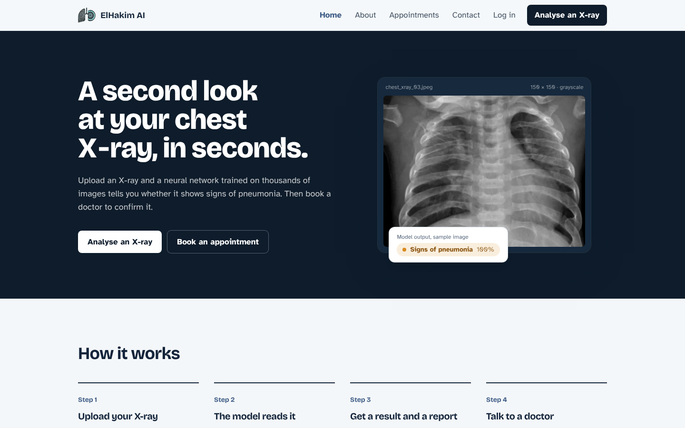
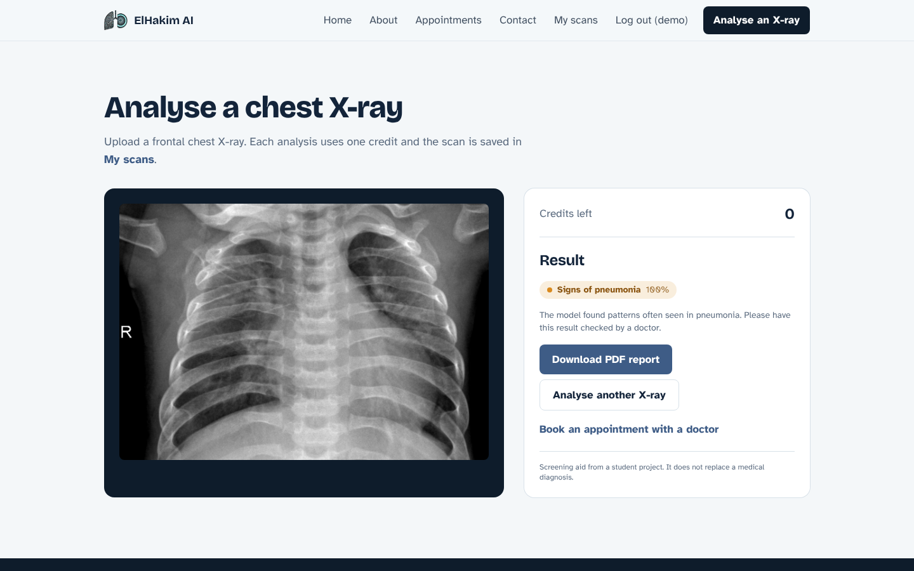
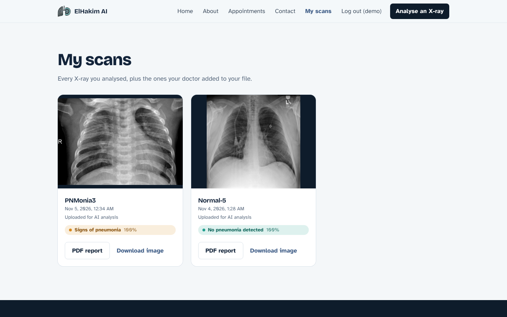
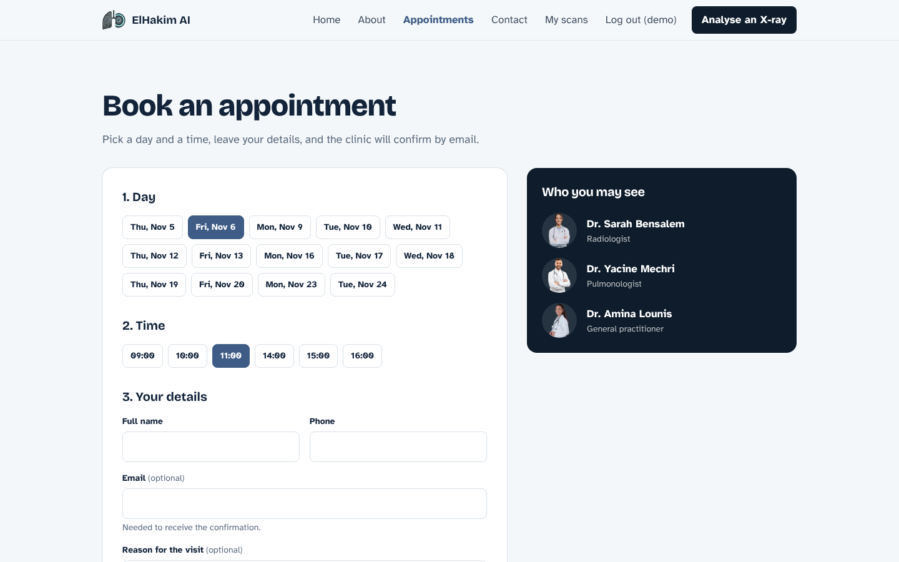
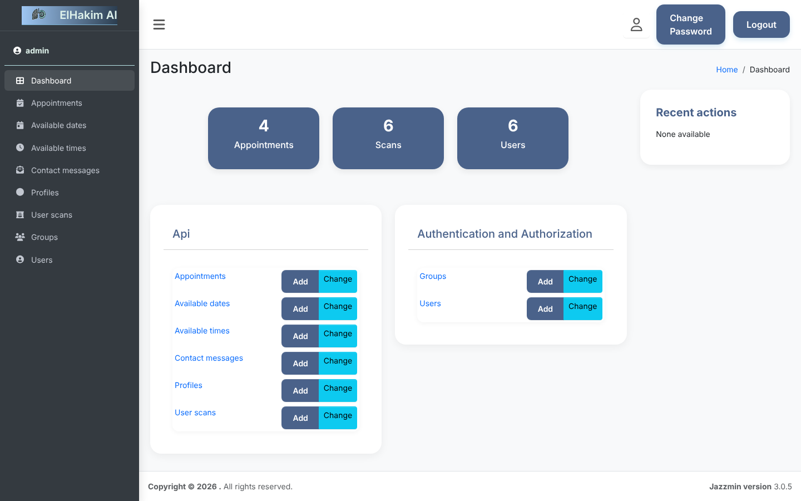
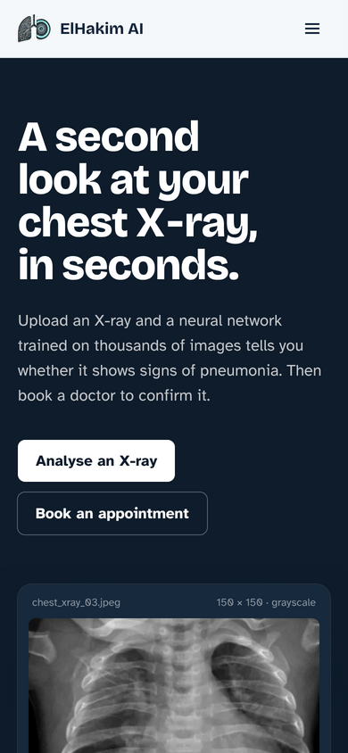

# ElHakim AI: pneumonia screening from chest X-rays

A full-stack web app where patients upload a chest X-ray, get an AI pneumonia screening in seconds, download a PDF report and book a consultation with a doctor.



> **Disclaimer:** this is a student project. The model is a screening demo, not a medical device, and its results must always be confirmed by a physician.

## Features

- **AI X-ray analysis:** a convolutional neural network (TensorFlow/Keras) classifies a chest X-ray as *Normal* or *Pneumonia* and returns its confidence.
- **PDF reports:** a downloadable report generated for each analysed scan.
- **Patient space:** JWT authentication (login with username or email), scan history, scan credits.
- **Demo payment:** buy scan credits through a mock CIB / Edahabia checkout. Nothing is charged.
- **Appointment booking:** pick a day and a free time slot. Double booking is blocked, and a cancelled slot becomes free again.
- **Contact form:** messages land in the admin, and the admin's reply is emailed to the patient.
- **Admin dashboard (Jazzmin):** manage appointments (confirmation and cancellation emails), opening hours, patient scans, credits and messages.
- **Responsive, accessible UI:** keyboard navigation, visible focus, reduced-motion support.

## Tech stack

| Layer | Tools |
| --- | --- |
| Frontend | React 19, React Router 7, Tailwind CSS 4, Vite, Axios |
| Backend | Django, Django REST Framework, Simple JWT, django-cors-headers |
| AI | TensorFlow / Keras, NumPy, Pillow |
| Other | xhtml2pdf (PDF reports), Jazzmin (admin), SQLite |

## Screenshots

| Analysis result | My scans |
| --- | --- |
|  |  |

| Appointment booking | Admin dashboard |
| --- | --- |
|  |  |

<p align="center"></p>

## The model

The classifier is a CNN built from scratch ([training notebook](backend/model/LastTimeTraining2.ipynb)):

- **Data:** about 14,000 frontal chest X-rays labelled *Normal* / *Pneumonia*, split 70 / 15 / 15 into train, validation and test sets.
- **Preprocessing:** grayscale, resized to 150 × 150, pixel values scaled to [0, 1]. The API applies exactly the same steps ([`backend/api/ml.py`](backend/api/ml.py)).
- **Architecture:** 4 convolution + max-pooling blocks (16 → 128 filters), a 128-unit dense layer with dropout and a sigmoid output (about 900k parameters). Trained for 15 epochs with Adam.
- **Decision:** a probability above 0.5 is reported as pneumonia.

**About the reported accuracy:** the notebook shows 99.9% test accuracy, but this figure is too optimistic. The split script seems to have been run twice into the same folders (4,028 test images were loaded instead of the 2,172 expected), so some images probably ended up in both the training and the test sets. A clean, patient-level re-split and a new evaluation are on the roadmap.

## Getting started

### Requirements

- Python 3.10+
- Node.js 20+

### 1. Backend (Django API)

```bash
cd backend
python -m venv venv
venv\Scripts\activate          # macOS / Linux: source venv/bin/activate
pip install -r requirements.txt

cp .env.example .env           # Windows: copy .env.example .env
# then set SECRET_KEY in .env
```

Generate a secret key with:

```bash
python -c "import secrets; print(secrets.token_urlsafe(50))"
```

Create the database, demo data and an admin account, then start the server:

```bash
python manage.py migrate
python manage.py seed_demo          # opening hours for the next 14 weekdays + a demo account
python manage.py createsuperuser
python manage.py runserver
```

- API: http://127.0.0.1:8000/
- Admin: http://127.0.0.1:8000/admin/
- Demo account: `demo` / `DemoPass123!` (3 free scans)

Without Gmail credentials in `.env`, emails are printed in the terminal instead of being sent.

### 2. Frontend (React)

```bash
cd frontend
cp .env.example .env           # Windows: copy .env.example .env
npm install
npm run dev
```

Open http://localhost:5173. Sample X-rays to try are in [`backend/samples/`](backend/samples).

### 3. Tests

```bash
cd backend
python manage.py test api
```

16 tests cover registration and login, contact messages, appointment rules, credits, predictions, PDF reports and permissions. The model is mocked, so the tests run without TensorFlow.

## Environment variables

| File | Variable | Description |
| --- | --- | --- |
| `backend/.env` | `SECRET_KEY` | Django secret key (required) |
| | `DEBUG` | `True` in development |
| | `ALLOWED_HOSTS`, `CORS_ALLOWED_ORIGINS` | Comma-separated lists |
| | `EMAIL_HOST_USER`, `EMAIL_HOST_PASSWORD` | Gmail account and [app password](https://support.google.com/accounts/answer/185833) (optional) |
| | `DEFAULT_FROM_EMAIL`, `ADMIN_EMAIL` | Sender and address that receives notifications (optional) |
| `frontend/.env` | `VITE_API_URL` | Backend URL, e.g. `http://127.0.0.1:8000` |

## API overview

| Method | Endpoint | Auth | Description |
| --- | --- | --- | --- |
| POST | `/api/user/register/` | | Create an account |
| POST | `/api/token/` | | Log in (username or email), returns JWT tokens |
| POST | `/api/token/refresh/` | | Refresh the access token |
| GET | `/api/profile/` | JWT | Username, email and remaining credits |
| POST | `/api/fake-payment/` | JWT | Demo payment: adds 3 credits |
| POST | `/api/predict-scan/` | JWT | Analyse an uploaded X-ray (uses 1 credit) |
| GET | `/api/user/scans/` | JWT | Scan history |
| POST | `/api/user/scans/<id>/analyze/` | JWT | Analyse a scan added by a doctor (free) |
| GET | `/api/user/scans/<id>/report/` | JWT | PDF report of an analysed scan |
| GET | `/api/available-dates/` | | Days open for booking |
| GET | `/api/available-times/?date=YYYY-MM-DD` | | Free time slots for a day |
| POST | `/api/appointments/` | | Book an appointment |
| POST | `/api/submit/` | | Send a contact message |

## Project structure

```
backend/
  api/            models, views, serializers, ML inference (ml.py), tests, email & PDF templates
  backend/        Django settings and URLs
  model/          trained CNN (.h5) and training notebook
  samples/        sample X-rays to try the app
frontend/
  src/pages/      one file per page (Home, AiCheck, Results, Appointment...)
  src/components/ layout, UI kit, payment modal
  src/context/    authentication state
  src/lib/        API client, static content
```

## My role

ElHakim AI started as a team project with [serine-saifi](https://github.com/serine-saifi). My contributions:

- **Model:** we each trained several CNNs and merged our work into the final model.
- **Frontend:** I built about 80% of the original React frontend. My teammate then improved some of the pages.
- **Contact feature:** built end to end, from the Django model and API to the form and the admin reply flow.

This repository is my reworked version of the project. I fixed backend bugs (email login, appointment slots, credit bypass, PDF results), added tests and demo data, moved secrets to environment variables, and rewrote and redesigned the frontend.

## Roadmap

- Re-split the dataset by patient and re-evaluate the model (precision, recall, confusion matrix).
- Show a heatmap (Grad-CAM) of the regions that drove the prediction.
- Deploy a public demo.
